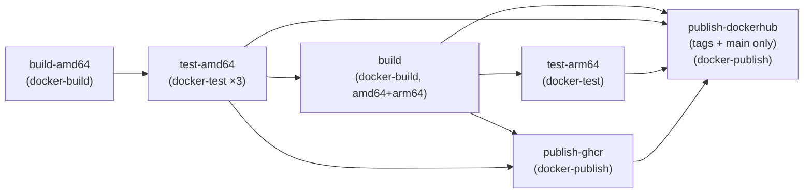
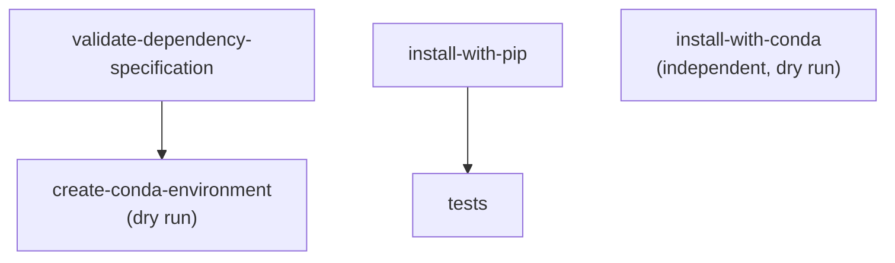
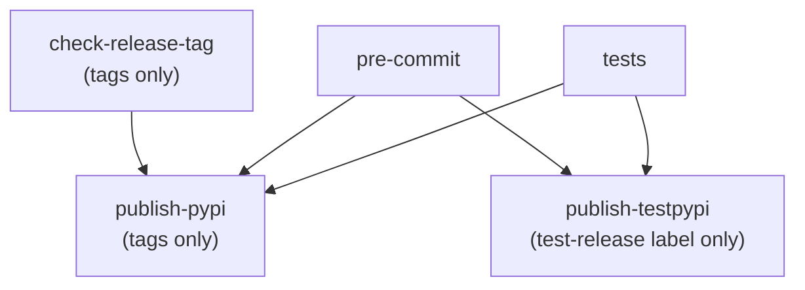
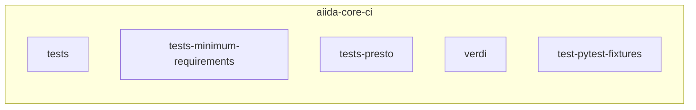

# CI dependency graph

> Tool choice: this graph is written in **Mermaid** (`flowchart`), which
> GitHub renders natively in markdown (READMEs, issues, PRs, wiki) with no
> build step. For slides or docs outside GitHub, export SVG/PNG with
> `npx @mermaid-js/mermaid-cli -i graph.mmd -o ci-graph.svg`.
> Source of truth: the `uses:` / `needs:` keys in the `.yml` files in this
> directory. Node titles match the workflow `name:` as shown in the
> GitHub Actions tab.

## 1. Workflow-level overview

Each package owns its workflows (`<package>-<workflow>.yml`); shared
build/test jobs live in `docker-*.yml`. Dashed arrows are
composite-action usage (`install-package` is shared across test and build jobs).

```mermaid
flowchart TB
    subgraph everyday["Every PR / push"]
        CICODE["aiida-core-ci"]
        CIATOM["aiida-atomistic-ci"]
        PRECOMMIT["pre-commit"]
        DOCS["aiida-core-docs"]
        DOCKERFORK["Build & Test Docker Images<br/>(forks only)"]
    end

    subgraph scheduled["Scheduled / manual"]
        NIGHTLY["nightly<br/>(daily + dispatch)"]
        TESTINSTALL["test-install<br/>(weekly + dispatch)"]
        BENCH["Performance benchmarks<br/>(push to main)"]
    end

    subgraph mainline["Push to main only"]
        DOCKER["Docker Images"]
    end

    subgraph tags["Tags / test releases"]
        RELEASE["aiida-core-release<br/>(vX.Y.Z tags)"]
        RELEASEATOM["aiida-atomistic-release<br/>(atomistic-vX.Y.Z tags)"]
    end

    subgraph reusable["Reusable workflows (workflow_call, never triggered directly)"]
        direction LR
        DBUILD["docker-build.yml"]
        DTEST["docker-test.yml"]
        DPUB["docker-publish.yml"]
    end

    subgraph actions["Composite actions"]
        direction LR
        INSTALL["install-package"]
    end

    DOCKER --> DBUILD
    DOCKER --> DTEST
    DOCKER --> DPUB

    CICODE -.-> INSTALL
    CIATOM -.-> INSTALL
    PRECOMMIT -.-> INSTALL
    DOCS -.-> INSTALL
    NIGHTLY -.-> INSTALL
    TESTINSTALL -.-> INSTALL
    BENCH -.-> INSTALL
    RELEASE -.-> INSTALL
    RELEASEATOM -.-> INSTALL
```

Trigger cheat-sheet (from each file's `on:`):

| Workflow | Trigger |
|---|---|
| `aiida-core-ci` | every push / PR (ignores `aiida-core/docs/**`) |
| `aiida-atomistic-ci` | only when `aiida-atomistic/**` changes |
| `pre-commit` | every push / PR |
| `aiida-core-docs` | only when `aiida-core/docs/**` changes |
| `Build & Test Docker Images` | PRs from forks only (no registry push) |
| `Docker Images` | pushes to `aiidateam/aiida-core` + manual dispatch |
| `Performance benchmarks` | pushes to `main` |
| `nightly` | daily cron + manual dispatch (+ PRs touching listed paths) |
| `test-install` | weekly cron + manual dispatch (+ PRs touching packaging files) |
| `aiida-core-release` / `aiida-atomistic-release` | version tags, plus PRs labelled `test-release` (→ TestPyPI) |

## 2. Job-level dependencies inside the orchestrator workflows

### `Docker Images` (`docker.yml`)

Fail-fast gate: `build-amd64` catches broken Dockerfiles before the slow
multi-arch build runs.

### `test-install` (`test-install.yml`)

### `aiida-core-release` / `aiida-atomistic-release`

## 3. `aiida-core-ci` internals

All five jobs are independent (no `needs:`) and inline — no shared
pytest template:

